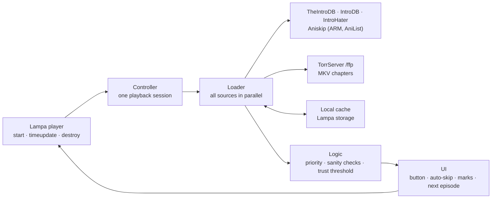

# Skip Intro for Lampa

[](https://github.com/emoorpheus/lampa-skip-intro/actions/workflows/ci.yml)
[](https://github.com/emoorpheus/lampa-skip-intro/releases)


A plugin for the [Lampa](https://github.com/yumata/lampa) media center: a **skip button** and optional **auto-skip** for intros,
recaps, credits and previews in TV shows, and for end credits in movies.

> **Version 1.1.0-beta.1 — a pre-release for testing.** New: an **English interface** (the plugin follows the Lampa language) and an
> attempted fix for missing timeline marks on Android TV. This beta has been checked by automated tests only. The stable version is
> [1.0.0](https://github.com/emoorpheus/lampa-skip-intro/releases/tag/v1.0.0), tested by the maintainer on an **LG OLED TV (webOS 25)**
> and an **Android TV box** — see [Tested devices](#tested-devices). Samsung Tizen has not been tested on a real device yet.

[Русская версия](README.ru.md)

## Contents

[Overview](#overview) · [Features](#features) · [Architecture](#architecture) · [Tested devices](#tested-devices) ·
[Installation](#installation) · [Settings](#settings) · [Language](#language) · [Privacy](#privacy) · [Known issues](#known-issues) ·
[Troubleshooting](#troubleshooting) · [For plugin developers](#for-plugin-developers) · [Development](#development)

## Overview

While you watch, the plugin looks up timestamps for the current episode in public community databases and shows
**Skip intro** at the right moment — press **OK** on the remote and playback jumps past the intro.
At the end credits of an episode it offers **Next episode** using Lampa's own playlist; in movies,
**Skip credits** jumps to the end of the credits, so a post-credits scene is not lost.

For anime it uses Aniskip; for torrents played through TorrServer it can read MKV chapters. When no database knows the
intro, a subtitle heuristic can find it (offered as a button only, never skipped automatically).

## Features

- **Timestamp sources**, combined by priority:
  [TheIntroDB](https://theintrodb.org), [IntroDB](https://introdb.app), [IntroHater](https://introhater.com),
  [Aniskip](https://aniskip.com) (anime: TMDB → MyAnimeList via [ARM](https://arm.haglund.dev), [AniList](https://anilist.co) search as a fallback),
  MKV chapters via TorrServer, and your own marks.
- **Segments:** intro, recap, credits, preview; credits in movies.
- **Button or auto-skip:** auto-skip with a countdown that **Back** cancels. A **trust threshold** decides what may be skipped
  automatically: timestamps with few confirmations are only offered as a button.
- **Next episode** at the credits through Lampa's playlist (the episode is marked as watched); timestamps of the next episode are prefetched.
- **Heuristics:** pauses in SRT/VTT subtitles, OP/ED songs in ASS subtitles, optional audio analysis (Web Audio, experimental).
- **Sanity checks:** implausible database entries are dropped — for example an "intro" that starts after max(10 min, 40 % of the file).
- **Per-show menu:** mode (as in settings / always auto-skip / button only / off), timestamp offset, your own intro and credits marks.
- **Timeline marks** on Lampa's progress bar and a warning 5 s before a segment.
- **Interface in Russian or English**, following the Lampa language ([Language](#language)).
- **Remote keys:** configurable keys for skip, cancel and the menu (including color keys).
- **Diagnostics** in the settings: status and response time of every source, a read-only **Check now**,
  the plugin version and statistics (number of skips and time saved).
- **Old TVs:** plain ES5 + `Promise`, CSS with `-webkit-` prefixes and without flex `gap`, no dependencies.
- **Optional:** CUB sync of per-show settings and marks (through Lampa's account), sending your marks to Aniskip
  (off by default, only on explicit action), dimming the button in HDR together with
  [Adaptive Subtitles](https://github.com/emoorpheus/lampa-adaptive-subtitles), handing timestamps to Lampa's built-in skip (experimental).
- **IntroDB proxy** for TV browsers — a small Python script for your home server ([docs/introdb-proxy.md](docs/introdb-proxy.md)).

## Architecture

The plugin is one file, `dist/autoskip.js`, built from `src/NN_*.js`. It has no server of its own: everything runs inside Lampa on your device.



1. **Session.** On Lampa's player `start` event the controller reads the card: TMDB id, season and episode, movie or anime.
   If the IMDb id is missing (IntroDB and IntroHater need it), it is requested through Lampa's own TMDB access.
2. **Loading.** All applicable sources are queried in parallel and applied as soon as each one answers, so a slow source
   does not delay the others. Every answer is cached per episode in Lampa's storage (keys `skip3_*`, at most 400 entries):
   timestamps for 7 days, "nothing found" for 12 hours.
3. **Combining.** For each segment type the first source in this order wins: your marks → MKV chapters → TheIntroDB → IntroDB →
   IntroHater → Aniskip → heuristics (for anime, Aniskip comes right after the chapters). Entries with an implausible position
   or length are dropped.
4. **Playback.** On every `timeupdate` the controller finds the current segment and shows the button, the countdown or the warning.
   Seeking works like Lampa's built-in skip; **Next episode** uses Lampa's playlist.
5. **Lampa integration.** Timeline marks use Lampa's classes (`player-panel__timeline-segment--skip`) and their own style
   (`.skip-intro-mark`, the look of Lampa 3.4.4), so they look like Lampa's marks and stay visible in builds with other timeline styles.
   If the video reports no finite duration, the marks use the end of `video.seekable`. In the hand-over mode Lampa draws the marks;
   if they have zero width or no segment styles, the plugin draws them itself. If the video source already passes skip segments to Lampa, the plugin stays idle and Lampa's built-in skip works.

**Network paths by platform**

| Platform | IntroDB | Other sources |
|---|---|---|
| Lampa Android app | a native request through the app (`Lampa.Reguest.native()` → `AndroidJS.httpReq`), no proxy needed | direct |
| LG webOS, Samsung Tizen, browsers | IntroDB answers browsers only for its own website (CORS) — use the [IntroDB proxy](docs/introdb-proxy.md) | direct |

The Android path is used only when the app reports version code 16 or newer — the same check Lampa makes before it calls `AndroidJS.httpReq`.
The proxy forwards only `GET /segments` of IntroDB with whitelisted parameters and adds the CORS headers a TV browser needs.

## Tested devices

Manual tests by the maintainer on 2026-11-01, **version 1.0.0**: the tested build was the internal 3.0.1 with the same code — only the
version string, the header comment and the optional author field differ. **1.1.0-beta.1 has not been tested on a TV yet.**

| Device | System and Lampa client | IntroDB requests | Result |
|---|---|---|---|
| LG OLED65M59LA | webOS 25, Lampa web app (served by Lampac) | through the [IntroDB proxy](docs/introdb-proxy.md) on a home server | timestamps from IntroDB (*Breaking Bad* S01E01, *House of the Dragon* S02E01), auto-skip, **Check now**, statistics; timeline marks shown |
| Tanix TX9 | Android TV, Lampa Android app (WebView) | native request through the app, no proxy | timestamps from IntroDB and IntroHater (*Breaking Bad* S01E01), skipping works; **timeline marks not shown** (1.0.0) — see [Known issues](#known-issues) |

Reports from other devices are welcome, especially Samsung Tizen and older webOS versions: [docs/tv-checklist.md](docs/tv-checklist.md).

## Installation

### Prerequisites

- **Lampa** with plugin support (Settings → Extensions). Developed against the Lampa 3.4.4 web build.
- **Internet access** from the device to the timestamp services (see [Privacy](#privacy)).
- Optional: **TorrServer** with the `/ffp` (ffprobe) endpoint — for MKV chapters.
- Optional: a **home server with Python 3.7+** — for the IntroDB proxy (webOS, Tizen, browsers).

### Step by step

1. In Lampa open **Settings → Extensions** («Настройки → Расширения» in Russian).
2. Select **Add Plugin** and enter the plugin URL:

   ```text
   https://emoorpheus.github.io/lampa-skip-intro/autoskip.js
   ```

   This address always serves the latest **stable** release (pre-releases are never published there). To try this beta,
   or to pin an exact version, use jsDelivr:

   ```text
   https://cdn.jsdelivr.net/gh/emoorpheus/lampa-skip-intro@v1.1.0-beta.1/dist/autoskip.js
   ```

3. Restart Lampa (close the app completely and open it again).
4. Open **Settings → Skip Intro → Diagnostics**: **Plugin version** shows **Skip Intro 1.1.0-beta.1** when the new file is loaded.
   Press **Check now** to see which sources are reachable from your network.
5. Play an episode that has known timestamps (for example *Game of Thrones* S01E01). When the intro starts,
   **Skip intro** appears — press **OK**.
6. *(webOS, Tizen, browsers)* Set up the [IntroDB proxy](docs/introdb-proxy.md) and enter `http://<YOUR_SERVER_IP>:8790/{url}` in
   **Skip Intro → Sources → IntroDB: proxy**. The Android app does not need it.

### Self-hosting (Lampac or any web server)

Serve `dist/autoskip.js` from your own server and add it by IP address — see [docs/self-hosting.md](docs/self-hosting.md).
Lampa adds its cache-busting `reset` parameter only to URLs **without** an IPv4 address, so a TV may keep an old copy after an update.
Put the version into the URL and change it with every update:

```text
http://<YOUR_SERVER_IP>:<PORT>/plugins/autoskip.js?v=1.1.0-beta.1
```

> Do not use `raw.githubusercontent.com` links: GitHub serves them as `text/plain` with `X-Content-Type-Options: nosniff`,
> and browsers refuse to execute such files as scripts.

## Settings

**Settings → Skip Intro** («Настройки → Пропуск заставок» in Russian). The most important options:

| Setting | Default | What it does |
|---|---|---|
| Enable plugin | on | Turns the plugin on or off |
| Always auto-skip | off | Skip without pressing OK, for timestamps that pass the trust threshold; heuristics are always offered as a button |
| Auto-skip confidence threshold | low | off / low / medium (2+ confirmations) / high (3+ confirmations); your marks and MKV chapters always pass, Aniskip too (except approximate matches at medium and high) |
| Segment types | intro, recap, credits on; preview off | Which segments get a button or auto-skip |
| Movies: skip credits | on | Credits in movies from IntroDB and TheIntroDB; a post-credits scene is kept |
| Hide the button after | 10 s | While the button is visible, OK skips instead of controlling the player |
| IntroDB: proxy | empty | `{url}`, `{encoded}` or a prefix; ignored in the Android app |
| Smart detection | on | Subtitle heuristic when the databases know nothing |
| Audio detection (experimental) | off | Experimental audio heuristic |
| Keys: skip / cancel / menu | OK / Back / none | Remote keys, color keys included |
| Fit credits to the file length | on | Credits at the end of the file move with the end of a longer or shorter file |
| Contribute to Aniskip | off | Allows sending your marks and votes to Aniskip, only on explicit action |
| Sync | off | Per-show settings and marks through your CUB account |
| Pass timestamps to Lampa (experimental) | off | Experimental: cached timestamps go to Lampa's built-in skip |

## Language

The plugin follows the Lampa interface language (**Settings → Interface → Interface language**): Russian when Lampa is in Russian,
English for every other language. Lampa restarts after you change the language, and the plugin's settings are built again in the
new language. Without a saved language Lampa runs in Russian, and so does the plugin.

All interface strings are in one table, [`src/05_i18n.js`](src/05_i18n.js). To add a language, add its code to `I18N_LANGS` and a column
to every string — see [CONTRIBUTING.md](CONTRIBUTING.md#translations). Log messages (`[SkipIntro] …`) are always in English.

## Privacy

The plugin has no server of its own and no analytics. Settings, statistics and the timestamp cache are stored in Lampa's local storage.

| Service | When | What is sent |
|---|---|---|
| TheIntroDB (`api.theintrodb.org`) | episodes and movies | TMDB id, season, episode, file duration |
| IntroDB (`api.introdb.app`, or your proxy) | episodes and movies | IMDb id, season, episode (movies: `is_movie=true`) |
| IntroHater (`introhater.com`) | episodes | IMDb id, season, episode |
| ARM (`arm.haglund.dev`), AniList (`graphql.anilist.co`) | anime only | TMDB id; title search |
| Aniskip (`api.aniskip.com`), reading | anime only | MyAnimeList id, episode, episode length |
| Aniskip, **submitting** | only if **Contribute to Aniskip** is enabled **and** you submit a mark or a vote | segment type, start/end, episode length, a random ID generated on your device |
| Your TorrServer | torrents | `/ffp` (chapters) and `/subs` requests, with Lampa's TorrServer login if you set one |
| CUB (through Lampa) | only if **Sync** is enabled | per-show settings and your marks |

IMDb ids are requested through Lampa's own TMDB access.

**Loading the plugin file** (this is Lampa's behaviour, not the plugin's): if the plugin URL contains no IPv4 address
(GitHub Pages, jsDelivr), Lampa appends `logged`, `reset`, `origin` (the host Lampa is opened from, in Base64) and, if you are
signed in to your Lampa (CUB) account, `email` (the account e-mail in Base64) to it — function `addPluginParams` in the Lampa 3.4.4
web build. The server that hosts the file receives these parameters with the request. To avoid this, serve the file from your
own server by IP address ([docs/self-hosting.md](docs/self-hosting.md)).

## Known issues

- **Android TV: no timeline marks (1.0.0).** In the Lampa Android app (tested on a Tanix TX9) the skip segments are not drawn on the
  progress bar, while skipping itself works. On LG webOS the same build draws them. The cause is not confirmed. In 1.0.0 the marks
  depend on the timeline styles of the Lampa build and are drawn only when the video reports a finite duration; in the hand-over mode
  they are left to Lampa, which draws its own marks once, with the duration known at `loadeddata`. **1.1.0-beta.1 tries to fix this**
  (own mark style, `video.seekable` as a fallback duration, a check that Lampa's own marks are visible in the hand-over mode) and tells
  what happened: player menu → **Sources** ends with “Timeline marks: 2”, a reason such as “none — the video length is unknown”
  or, in the hand-over mode, “Lampa draws the timeline marks”, and the log has a `[SkipIntro] Timeline marks: …` line.
  Please report that line and whether **Pass timestamps to Lampa** is on ([issue template](.github/ISSUE_TEMPLATE/bug_report.md)); the player menu needs a key, see **Keys → Skip menu key**.
- **IntroDB in TV browsers needs the proxy** (CORS, see [Architecture](#architecture)); without it Diagnostics shows
  “IntroDB: no response (CORS or no network?)”, and the other sources still work.
- **Samsung Tizen** has not been tested on a real device.
- **Self-hosted by IP:** after an update the TV may keep the old file — use `?v=<version>` (see [Installation](#self-hosting-lampac-or-any-web-server)).

## Troubleshooting

- **Diagnostics shows an old version.** Restart Lampa; for a self-hosted URL change `?v=` ([docs/self-hosting.md](docs/self-hosting.md#updating-and-cache)).
- **No button for a title.** The databases may simply have no timestamps for it yet; check **Check now** and the per-show mode in the player menu.
- **A skip lands in the wrong place.** Use the per-show offset in the player menu, or mark the intro yourself (player menu → **This episode**).
- **Console logs.** Lines start with `[SkipIntro]`. On Android: `adb logcat | grep -F "[SkipIntro]"` (WebView console messages appear in logcat).

## For plugin developers

- The button is dimmed in HDR when another plugin sends the Lampa event `adaptive_subs` with
  `{ type: 'profile', profile: 'hdr' | 'sdr', brightness: 0..1 }` (sent by Adaptive Subtitles).
- TorrServer ffprobe results are shared through `window.__lampa_ffp__` (v1):
  `get(base, hash, index, authHeader, timeoutMs) → Promise<{ status, json }>` — one `/ffp` request per file for all plugins; an existing implementation is never replaced.

## Development

```sh
npm test         # build src/ -> dist/autoskip.js (ES5 check) + unit tests; no npm install needed
npm run check    # scan for IP addresses, e-mails, tokens and personal paths before pushing
```

End-to-end tests, the release process and the rules for contributions: [CONTRIBUTING.md](CONTRIBUTING.md). Changes: [CHANGELOG.md](CHANGELOG.md).

## Credits

- Timestamps: TheIntroDB, IntroDB (intro data provided by IntroDB, [introdb.app](https://introdb.app)), IntroHater, Aniskip; anime ids: ARM and AniList. Thank you to everyone who contributes timestamps.
- [Lampa](https://github.com/yumata/lampa) by yumata.
- [acorn](https://github.com/acornjs/acorn) (MIT) — used only for build checks.

## Disclaimer

This is an independent, unofficial project. It is not affiliated with or endorsed by the authors of Lampa, Lampac, TorrServer,
the timestamp services listed above, LG, Samsung or Google.

**Installing third-party plugins, enabling developer mode or sideloading apps on a TV or set-top box, and running a self-hosted proxy
on your server are done entirely at your own risk.** Such changes may violate the terms of your device or service, void the warranty or
affect the stability and security of your device and network. The software is provided "as is", without warranty of any kind
(see [LICENSE](LICENSE)). The authors are not liable for any damage, data loss or service bans resulting from its use.

Timestamp data comes from third-party community services; it may be inaccurate, and each service has its own terms of use
(for IntroDB: [introdb.app/docs/terms](https://introdb.app/docs/terms)). Respect them — in particular, do not use this project for bulk downloading.

## License

[MIT](LICENSE)
