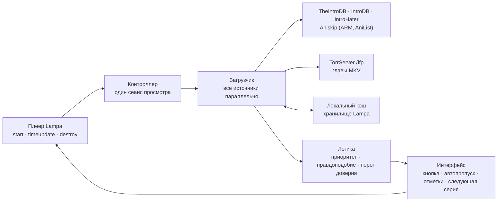

# Пропуск заставок для Lampa (Skip Intro)

[](https://github.com/emoorpheus/lampa-skip-intro/actions/workflows/ci.yml)
[](https://github.com/emoorpheus/lampa-skip-intro/releases)


Плагин для медиацентра [Lampa](https://github.com/yumata/lampa): **кнопка пропуска** и по желанию **автопропуск** заставок,
рекапов, титров и превью в сериалах, а также финальных титров в фильмах.

> **Версия 1.1.1** — экран **«Отчёт для разработчика»** (Настройки → Пропуск заставок → Диагностика): версии, источники, отметки
> на шкале и журнал на одном экране, который достаточно сфотографировать; адреса, названия файлов и ключи скрыты. В первой серии
> сериала повтор из баз больше не пропускается. Новое в 1.1:
> **английский интерфейс** (плагин следует языку Lampa), отметки на шкале в Android TV, пропуск таймкодов, которые передаёт источник
> видео (например, онлайн-балансер), по настройкам плагина, и исправления, найденные на приставке Android TV. Автор проверил плагин на
> **телевизоре LG OLED (webOS 25)** и **приставке Android TV (Tanix TX9)** — см. [Проверенные устройства](#проверенные-устройства).
> На настоящем Samsung Tizen пока не проверялось.

[Версия на английском](README.md)

## Содержание

[Обзор](#обзор) · [Возможности](#возможности) · [Архитектура](#архитектура) · [Проверенные устройства](#проверенные-устройства) ·
[Установка](#установка) · [Настройки](#настройки) · [Язык](#язык) · [Приватность](#приватность) · [Известные проблемы](#известные-проблемы) ·
[Если что-то не работает](#если-что-то-не-работает) · [Для разработчиков плагинов](#для-разработчиков-плагинов) · [Разработка](#разработка)

## Обзор

Во время просмотра плагин ищет таймкоды текущей серии в открытых базах сообщества и в нужный момент показывает
**«Пропустить заставку»** — нажмите **OK** на пульте, и видео перемотается за заставку. На финальных титрах серии плагин
предлагает **«Следующая серия»** через плейлист самой Lampa; в фильмах **«Пропустить титры»** перематывает к концу титров,
поэтому сцена после титров не теряется.

Для аниме используется Aniskip; у торрентов через TorrServer плагин умеет читать главы MKV. Если заставки нет ни в одной базе,
её может найти эвристика по субтитрам (результат предлагается только кнопкой и никогда не пропускается автоматически).

## Возможности

- **Источники таймкодов** с объединением по приоритету:
  [TheIntroDB](https://theintrodb.org), [IntroDB](https://introdb.app), [IntroHater](https://introhater.com),
  [Aniskip](https://aniskip.com) (аниме: TMDB → MyAnimeList через [ARM](https://arm.haglund.dev), запасной путь — поиск в [AniList](https://anilist.co)),
  главы MKV через TorrServer и ваши собственные отметки. Таймкоды, которые источник видео (например, онлайн-балансер) передаёт
  в Lampa, тоже пропускаются по настройкам плагина.
- **Сегменты:** заставка, рекап, титры, превью; титры в фильмах.
- **Кнопка или автопропуск:** автопропуск с обратным отсчётом и кнопкой «Отменить». **Порог доверия** решает, что можно
  пропускать автоматически: таймкоды с малым числом подтверждений предлагаются только кнопкой.
- **Следующая серия** на титрах через плейлист Lampa (серия отмечается просмотренной); таймкоды следующей серии загружаются заранее.
- **Эвристики:** паузы в субтитрах SRT/VTT, песни OP/ED в субтитрах ASS, по желанию — анализ звука (Web Audio, эксперимент).
- **Проверка правдоподобия:** неправдоподобные записи баз отбрасываются — например, «заставка», которая начинается позже max(10 мин, 40 % длины файла).
- **Меню сериала:** режим (как в настройках / всегда автопропуск / только кнопка / выключен), сдвиг таймкодов, свои отметки заставки и титров.
- **Отметки на шкале** воспроизведения Lampa и предупреждение за 5 с до сегмента.
- **Интерфейс на русском или английском** — по языку Lampa ([Язык](#язык)).
- **Клавиши пульта:** настраиваемые клавиши пропуска, отмены и меню (в том числе цветные).
- **Диагностика** в настройках: состояние и время ответа каждого источника, «Проверить сейчас» (только чтение),
  версия плагина, отметки на шкале при последнем просмотре и статистика (число пропусков и сэкономленное время).
- **Отчёт для разработчика:** один экран крупным текстом — версии, платформа, изменённые настройки, источники, отметки на шкале и
  последние 30 строк журнала; сфотографируйте его и приложите к обращению. Ничего не отправляется; адреса, названия файлов и ключи скрыты.
- **Старые ТВ:** чистый ES5 + `Promise`, CSS с префиксами `-webkit-` и без flex `gap`, без зависимостей.
- **По желанию:** синхронизация настроек сериалов и отметок через аккаунт CUB (средствами Lampa), отправка ваших отметок в Aniskip
  (по умолчанию выключено, только по явной команде), приглушение кнопки в HDR вместе с плагином
  [«Адаптивные субтитры»](https://github.com/emoorpheus/lampa-adaptive-subtitles), передача таймкодов встроенному пропуску Lampa (эксперимент).
- **Прокси IntroDB** для браузеров ТВ — небольшой скрипт на Python для домашнего сервера ([docs/introdb-proxy.ru.md](docs/introdb-proxy.ru.md)).

## Архитектура

Плагин — один файл `dist/autoskip.js`, собранный из `src/NN_*.js`. Своего сервера у него нет: всё работает внутри Lampa на вашем устройстве.



1. **Сеанс.** По событию плеера Lampa `start` контроллер читает карточку: id TMDB, сезон и серию, фильм это или аниме.
   Если нет id IMDb (он нужен IntroDB и IntroHater), плагин запрашивает его через доступ Lampa к TMDB.
2. **Загрузка.** Все подходящие источники опрашиваются параллельно, и ответ каждого применяется сразу, поэтому медленный
   источник не задерживает остальные. Каждый ответ кэшируется для серии в хранилище Lampa (ключи `skip3_*`, не больше 400 записей):
   таймкоды — на 7 дней, «ничего нет» — на 12 часов.
3. **Объединение.** Для каждого типа сегмента побеждает первый источник в порядке: ваши отметки → таймкоды источника видео → главы MKV → TheIntroDB → IntroDB →
   IntroHater → Aniskip → эвристики (для аниме Aniskip идёт сразу после глав). Записи с неправдоподобным положением или длиной отбрасываются.
4. **Воспроизведение.** На каждом `timeupdate` контроллер находит текущий сегмент и показывает кнопку, обратный отсчёт или предупреждение.
   Перемотка работает так же, как встроенный пропуск Lampa; «Следующая серия» использует плейлист Lampa.
5. **Связь с Lampa.** Отметки на шкале используют классы Lampa (`player-panel__timeline-segment--skip`) и собственный стиль
   (`.skip-intro-mark`, как в Lampa 3.4.4), поэтому выглядят как отметки Lampa и видны в сборках с другими стилями шкалы.
   Если видео не сообщает конечную длительность, для отметок берётся конец `video.seekable`. При передаче таймкодов в Lampa отметки
   рисует Lampa; если у них нулевая ширина или нет стилей сегментов, плагин рисует их сам.
6. **Таймкоды источника видео.** Если источник видео (например, онлайн-балансер) сам передаёт таймкоды (`data.segments`), плагин
   пропускает их по своим настройкам (кнопка или автопропуск, типы сегментов, режим сериала). Встроенный плеер Lampa на время
   события `start` получает пустые сегменты ([L21269-21315](https://github.com/yumata/lampa/blob/4294a571aad8883116e57d975ad05519f84be13e/app.min.js#L21269-L21315)), поэтому своей кнопки пропуска и уведомления Lampa
   не показывает; потом `data.segments` возвращаются как были, внешние плееры получают их без изменений. Плагин берёт те же
   сегменты, что пропустила бы Lampa 3.4.4 (перенос, с её пересчётом под длину файла), и называет их: `ad` — реклама, сегмент у
   конца файла — титры, у начала — заставка. В сериале с режимом «Выключен» и для выключенного типа сегмента они не пропускаются
   вовсе. При передаче таймкодов в Lampa, с выключенным плагином или для фильма с выключенной настройкой «Фильмы: пропуск титров»
   их пропускает Lampa.

**Сетевые пути на разных платформах**

| Платформа | IntroDB | Остальные источники |
|---|---|---|
| Android-приложение Lampa | нативный запрос через приложение (`Lampa.Reguest.native()` → `AndroidJS.httpReq`), прокси не нужен | напрямую |
| LG webOS, Samsung Tizen, браузеры | IntroDB отвечает браузерам только для своего сайта (CORS) — нужен [прокси IntroDB](docs/introdb-proxy.ru.md) | напрямую |

Путь через Android включается, только если приложение сообщает код версии 16 или новее — так же Lampa проверяет приложение перед вызовом `AndroidJS.httpReq`.
Прокси пропускает только `GET /segments` IntroDB с разрешёнными параметрами и добавляет заголовки CORS, нужные браузеру ТВ.

## Проверенные устройства

Ручная проверка автором: **1.1.1** — 2026-11-04 (TX9: экран отчёта и исправление для первой серии; телевизор LG),
**1.1.0** — 2026-11-03 (на TX9 стояла сборка с тем же кодом под предварительным номером версии, отличается
только строка версии), **1.0.0** — 2026-11-01 (внутренняя сборка 3.0.1 с тем же кодом).

| Устройство | Система и клиент Lampa | Запросы к IntroDB | Результат |
|---|---|---|---|
| LG OLED65M59LA | webOS 25, веб-приложение Lampa (с сервера Lampac) | через [прокси IntroDB](docs/introdb-proxy.ru.md) на домашнем сервере | **1.1.1:** проблем не найдено. **1.1.0:** проблем не найдено. **1.0.0:** таймкоды из IntroDB («Во все тяжкие» S01E01, «Дом Дракона» S02E01), автопропуск, «Проверить сейчас», статистика; отметки на шкале видны |
| Tanix TX9 | Android 11 (Android TV), Android-приложение Lampa 1.12.4 (WebView 84) | нативный запрос через приложение, без прокси | **1.1.1** (Lampa 3.4.4, WebView Chrome 156): отчёт открывается из «Диагностики» и читается на снимке экрана 1080p; стрелка вниз и «Назад» (через `adb`) прокручивают и закрывают его; тестовое видео, запущенное как «Наруто» S01E01, после заставки идёт дальше без пропуска повтора из баз (1:42–2:40 и 1:44–3:03). **1.1.0:** план проверок через `adb`: кнопка и автопропуск, обратный отсчёт и «Назад», «Следующая серия», титры фильмов, режимы и сдвиг сериала, свои отметки, таймкоды онлайн-источника, передача таймкодов в Lampa, английский интерфейс; отметки на шкале видны. Цветные кнопки посылались через `adb`, а не нажимались на пульте. **1.0.0:** пропуск работал, отметок на шкале не было |

Отчёты с других устройств очень помогут, особенно с Samsung Tizen и старых версий webOS: [docs/tv-checklist.ru.md](docs/tv-checklist.ru.md).

## Установка

### Что нужно

- **Lampa** с поддержкой плагинов (Настройки → Расширения). Плагин разрабатывался для веб-сборки Lampa 3.4.4.
- **Доступ в интернет** с устройства к сервисам таймкодов (см. [Приватность](#приватность)).
- По желанию: **TorrServer** с адресом `/ffp` (ffprobe) — для глав MKV.
- По желанию: **домашний сервер с Python 3.7+** — для прокси IntroDB (webOS, Tizen, браузеры).

### По шагам

1. В Lampa откройте **Настройки → Расширения**.
2. Выберите **«Добавить плагин»** и введите адрес:

   ```text
   https://emoorpheus.github.io/lampa-skip-intro/autoskip.js
   ```

   По этому адресу всегда последний **стабильный** выпуск. Чтобы закрепить точную версию, используйте jsDelivr:

   ```text
   https://cdn.jsdelivr.net/gh/emoorpheus/lampa-skip-intro@v1.1.1/dist/autoskip.js
   ```

3. Перезапустите Lampa (полностью закройте приложение и откройте снова).
4. Откройте **Настройки → Пропуск заставок → Диагностика**: строка **«Версия плагина: Skip Intro 1.1.1»** подтверждает, что загружен новый файл.
   Нажмите **«Проверить сейчас»** — будет видно, какие источники доступны из вашей сети.
5. Включите серию с известными таймкодами (например, «Игра престолов» S01E01). Когда начнётся заставка,
   появится **«Пропустить заставку»** — нажмите **OK**.
6. *(webOS, Tizen, браузеры)* Настройте [прокси IntroDB](docs/introdb-proxy.ru.md) и укажите `http://<YOUR_SERVER_IP>:8790/{url}` в
   **Пропуск заставок → Источники → «IntroDB: прокси»**. Android-приложению он не нужен.

### Свой сервер (Lampac или любой веб-сервер)

Раздавайте `dist/autoskip.js` со своего сервера и подключайте по IP-адресу — см. [docs/self-hosting.ru.md](docs/self-hosting.ru.md).
Параметр против кэша `reset` Lampa добавляет только к адресам **без** IPv4, поэтому после обновления ТВ может держать старую копию.
Укажите версию в адресе и меняйте её при каждом обновлении:

```text
http://<YOUR_SERVER_IP>:<PORT>/plugins/autoskip.js?v=1.1.1
```

> Не используйте ссылки `raw.githubusercontent.com`: GitHub отдаёт их как `text/plain` с `X-Content-Type-Options: nosniff`,
> и браузеры отказываются выполнять такие файлы как скрипты.

## Настройки

**Настройки → Пропуск заставок.** Главное:

| Настройка | По умолчанию | Что делает |
|---|---|---|
| «Включить плагин» | вкл. | Включает и выключает плагин |
| «Всегда автопропуск» | выкл. | Пропуск без нажатия OK для таймкодов, прошедших порог доверия; найденное эвристикой — всегда только кнопкой |
| «Порог доверия для автопропуска» | низкий | не проверять / низкий / средний (от 2 подтверждений) / высокий (от 3); ваши отметки и главы MKV проходят всегда, Aniskip тоже (кроме приблизительных совпадений на среднем и высоком). Если таймкоды первой по приоритету базы порог не проходят, а другой базы проходят, сегмент пропускается автоматически: по таймкодам первой базы, если они лежат внутри уверенного сегмента (± 10 с), иначе — по таймкодам уверенной |
| Типы сегментов | заставка, рекап, титры — вкл.; превью — выкл. | Для каких сегментов кнопка или автопропуск |
| «Фильмы: пропуск титров» | вкл. | Титры фильмов из IntroDB и TheIntroDB; сцена после титров сохраняется |
| «Скрывать кнопку через» | 10 с | Пока кнопка видна, OK пропускает сегмент, а не управляет плеером |
| «IntroDB: прокси» | пусто | `{url}`, `{encoded}` или префикс; в Android-приложении не используется |
| «Умное обнаружение» | вкл. | Эвристика по субтитрам, если в базах ничего нет |
| «Обнаружение по звуку (эксперимент)» | выкл. | Экспериментальная эвристика по звуку |
| Клавиши: пропуск / отмена / меню | OK / Назад / нет | Клавиши пульта, в том числе цветные |
| «Подгонять титры под длину файла» | вкл. | Титры у конца файла сдвигаются вместе с концом, если файл длиннее или короче (до 2 мин) |
| «Помогать Aniskip» | выкл. | Разрешает отправку ваших отметок и голосов в Aniskip, только по явной команде |
| «Синхронизация» | выкл. | Настройки сериалов и отметки через аккаунт CUB |
| «Отдавать таймкоды в Lampa (эксперимент)» | выкл. | Таймкоды из кэша передаются встроенному пропуску Lampa |

## Язык

Плагин следует языку интерфейса Lampa (**Настройки → Интерфейс → Язык интерфейса**): русский, когда Lampa на русском, английский —
для всех остальных языков. После смены языка Lampa перезапускается, и раздел настроек плагина собирается заново на новом языке.
Если язык в Lampa ещё не выбирали, Lampa работает на русском — и плагин тоже.

Все строки интерфейса — в одной таблице, [`src/05_i18n.js`](src/05_i18n.js). Чтобы добавить язык, допишите его код в `I18N_LANGS`
и перевод в каждую строку — см. [CONTRIBUTING.md](CONTRIBUTING.md#translations). Сообщения журнала (`[SkipIntro] …`) всегда на английском.

## Приватность

У плагина нет своего сервера и нет аналитики. Настройки, статистика и кэш таймкодов хранятся в локальном хранилище Lampa.

| Сервис | Когда | Что отправляется |
|---|---|---|
| TheIntroDB (`api.theintrodb.org`) | серии и фильмы | id TMDB, сезон, серия, длина файла |
| IntroDB (`api.introdb.app` или ваш прокси) | серии и фильмы | id IMDb, сезон, серия (фильмы: `is_movie=true`) |
| IntroHater (`introhater.com`) | серии | id IMDb, сезон, серия |
| ARM (`arm.haglund.dev`), AniList (`graphql.anilist.co`) | только аниме | id TMDB; поиск по названию |
| Aniskip (`api.aniskip.com`), чтение | только аниме | id MyAnimeList, серия, длина серии |
| Aniskip, **отправка** | только если включено «Помогать Aniskip» **и** вы отправляете отметку или голос | тип сегмента, начало/конец, длина серии, случайный ID, созданный на вашем устройстве |
| Ваш TorrServer | торренты | запросы `/ffp` (главы) и `/subs`, с логином TorrServer из Lampa, если он задан |
| CUB (через Lampa) | только если включена «Синхронизация» | настройки сериалов и ваши отметки |

id IMDb запрашиваются через доступ самой Lampa к TMDB.

**Загрузка файла плагина** (это поведение Lampa, а не плагина): если в адресе плагина нет IPv4-адреса (GitHub Pages, jsDelivr),
Lampa добавляет к нему `logged`, `reset`, `origin` (адрес, с которого открыта Lampa, в Base64) и, если вы вошли в аккаунт
Lampa (CUB), `email` (почта аккаунта в Base64) — функция `addPluginParams` в веб-сборке Lampa 3.4.4. Сервер, на котором лежит файл,
получает эти параметры вместе с запросом. Чтобы этого избежать, раздавайте файл со своего сервера по IP-адресу ([docs/self-hosting.ru.md](docs/self-hosting.ru.md)).

## Известные проблемы

- **IntroDB в браузерах ТВ работает только через прокси** (CORS, см. [Архитектура](#архитектура)); без него «Диагностика» показывает
  «IntroDB: нет ответа (возможно, CORS или нет сети)», а остальные источники работают.
- **Samsung Tizen** на настоящем устройстве не проверялся.
- **Файлы, которые отличаются от эталонного файла базы** (например, копия из онлайн-источника с рекламой в начале): заставки не
  сдвигаются, под длину файла подгоняются только титры у конца (до 2 мин, «Подгонять титры под длину файла»). Задайте сдвиг для
  сериала в меню плеера или отметьте сегмент сами.
- **Свой сервер по IP:** после обновления ТВ может держать старый файл — используйте `?v=<версия>` (см. [Установка](#свой-сервер-lampac-или-любой-веб-сервер)).

## Если что-то не работает

- **Как сообщить о проблеме.** Сразу после неё откройте **Настройки → Пропуск заставок → Диагностика → Отчёт для разработчика**,
  сфотографируйте экран (стрелка вниз прокручивает) и приложите снимок к [обращению](https://github.com/emoorpheus/lampa-skip-intro/issues)
  с названием и серией.
- **В «Диагностике» старая версия.** Перезапустите Lampa; для своего сервера смените `?v=` ([docs/self-hosting.ru.md](docs/self-hosting.ru.md#обновление-и-кэш)).
- **Нет кнопки у какого-то тайтла.** Возможно, в базах для него просто ещё нет таймкодов: проверьте «Проверить сейчас» и режим сериала в меню плеера.
- **Пропуск попадает не туда.** Задайте сдвиг для сериала в меню плеера или отметьте заставку сами (меню → «Эта серия»).
- **Журнал в консоли.** Строки начинаются с `[SkipIntro]`. На Android: `adb logcat | grep -F "[SkipIntro]"` (сообщения консоли WebView попадают в logcat).

## Для разработчиков плагинов

- Кнопка приглушается в HDR, когда другой плагин отправляет событие Lampa `adaptive_subs` с
  `{ type: 'profile', profile: 'hdr' | 'sdr', brightness: 0..1 }` (его отправляет «Адаптивные субтитры»).
- Результаты ffprobe из TorrServer общие через `window.__lampa_ffp__` (v1):
  `get(base, hash, index, authHeader, timeoutMs) → Promise<{ status, json }>` — один запрос `/ffp` на файл для всех плагинов; уже существующая реализация не заменяется.

## Разработка

```sh
npm test         # сборка src/ -> dist/autoskip.js (проверка ES5) + модульные тесты; npm install не нужен
npm run check    # поиск IP-адресов, почты, токенов и личных путей перед публикацией
```

Сценарии E2E, порядок выпуска и правила для участников: [CONTRIBUTING.md](CONTRIBUTING.md) (на английском). Изменения: [CHANGELOG.md](CHANGELOG.md).

Плагин разрабатывался с помощью моделей ИИ Opus 5.5 и Gemini 3.8 Flash. Указания для ИИ-помощников (сборка, тесты, правила,
проверка перед публикацией) — в [AGENTS.md](AGENTS.md); [CLAUDE.md](CLAUDE.md) отсылает Claude Code к тому же файлу.

## Благодарности

- Таймкоды: TheIntroDB, IntroDB (данные о заставках предоставлены IntroDB, [introdb.app](https://introdb.app)), IntroHater, Aniskip; id аниме: ARM и AniList. Спасибо всем, кто добавляет таймкоды.
- [Lampa](https://github.com/yumata/lampa) от yumata.
- [acorn](https://github.com/acornjs/acorn) (MIT) — только для проверок при сборке.

## Отказ от ответственности

Это независимый неофициальный проект. Он не связан с авторами Lampa, Lampac, TorrServer, перечисленных выше сервисов таймкодов,
LG, Samsung или Google и не одобрен ими.

**Установка сторонних плагинов, включение режима разработчика или установка приложений в обход магазина на ТВ или приставке,
а также запуск прокси на своём сервере — полностью на ваш риск.** Такие изменения могут нарушать условия использования устройства
или сервиса, лишить гарантии, повлиять на стабильность и безопасность устройства и сети. Программа предоставляется «как есть»,
без каких-либо гарантий (см. [LICENSE](LICENSE)). Авторы не несут ответственности за ущерб, потерю данных или блокировки, возникшие при её использовании.

Таймкоды берутся из сторонних сервисов сообщества; они могут быть неточными, и у каждого сервиса свои условия использования
(для IntroDB: [introdb.app/docs/terms](https://introdb.app/docs/terms)). Соблюдайте их — в частности, не используйте проект для массовой выкачки данных.

## Лицензия

[MIT](LICENSE)
